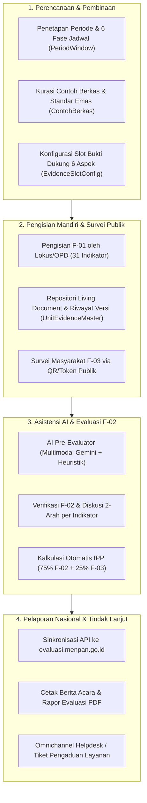

# KERANGKA ACUAN KERJA (KAK) / TERM OF REFERENCE (TOR)
## PENGEMBANGAN DAN PENYELENGGARAAN SISTEM INFORMASI PEMANTAUAN DAN EVALUASI KINERJA PENYELENGGARAAN PELAYANAN PUBLIK (PEKPPP) MANDIRI TERINTEGRASI
### PEMERINTAH KABUPATEN KUTAI BARAT

---

### 1. LATAR BELAKANG
Pelayanan publik yang berkualitas, cepat, mudah, terjangkau, dan terukur merupakan amanat Undang-Undang Nomor 25 Tahun 2009 tentang Pelayanan Publik. Untuk mengukur keberhasilan penyelenggaraan pelayanan publik secara objektif dan berkala, Kementerian Pendayagunaan Aparatur Negara dan Reformasi Birokrasi (KemenPAN-RB) menetapkan instrumen Pemantauan dan Evaluasi Kinerja Penyelenggaraan Pelayanan Publik (PEKPPP) sebagaimana diatur dalam Peraturan Menteri PANRB Nomor 29 Tahun 2022 beserta pedoman pelaksanaannya.

Dalam menyelenggarakan **PEKPPP Mandiri** di tingkat Pemerintah Daerah Kabupaten Kutai Barat yang mencakup puluhan Unit Penyelenggara Pelayanan Publik (UPPP) — mulai dari Perangkat Daerah (OPD), Kecamatan, RSUD, hingga Puskesmas — Bagian Organisasi Sekretariat Daerah menghadapi sejumlah tantangan struktural pada pola konvensional:
1. **Fragmentasi Bukti Dukung:** Pengumpulan bukti dukung 31 indikator pada 6 aspek evaluasi melalui tautan penyimpanan awan (*Google Drive*) yang terpisah-pisah menyulitkan penelusuran, rawan tautan rusak (*broken link*), dan tidak terstandarisasi.
2. **Beban Unggah Berulang Setiap Tahun (*Redundant Upload*):** Dokumen kebijakan yang bersifat tetap (seperti SK Standar Pelayanan, Maklumat Pelayanan, atau SOP yang belum berubah) harus diunggah ulang dari awal setiap tahun evaluasi oleh OPD.
3. **Beban Verifikasi Tim Evaluator Daerah:** Keterbatasan jumlah personel Tim Evaluator Daerah dibandingkan dengan banyaknya dokumen PDF/foto yang harus diperiksa secara mendalam (misal: kelengkapan 14 komponen Standar Pelayanan pada setiap jenis layanan) berisiko menurunkan ketelitian verifikasi.
4. **Ketidaksinkronan Pelaporan ke Portal Nasional:** Proses pemindahan data hasil evaluasi daerah (F-01, F-02, dan F-03) ke portal nasional `evaluasi.menpan.go.id` membutuhkan waktu rekapitulasi manual yang panjang.

Untuk menjawab permasalahan tersebut, Pemerintah Kabupaten Kutai Barat merancang dan mengimplementasikan **Portal PEKPPP Mandiri Terintegrasi** yang mengedepankan konsep **Living Document Repository**, **AI Pre-Evaluator (Asisten Verifikasi Cerdas)**, serta **Interoperabilitas API langsung ke Sistem Nasional KemenPAN-RB**.

---

### 2. DASAR HUKUM
1. Undang-Undang Nomor 25 Tahun 2009 tentang Pelayanan Publik.
2. Peraturan Pemerintah Nomor 96 Tahun 2012 tentang Pelaksanaan Undang-Undang Nomor 25 Tahun 2009 tentang Pelayanan Publik.
3. Peraturan Presiden Nomor 95 Tahun 2018 tentang Sistem Pemerintahan Berbasis Elektronik (SPBE).
4. Peraturan Menteri PANRB Nomor 15 Tahun 2014 tentang Pedoman Standar Pelayanan.
5. Peraturan Menteri PANRB Nomor 14 Tahun 2017 tentang Pedoman Penyusunan Survei Kepuasan Masyarakat Unit Penyelenggara Pelayanan Publik.
6. Peraturan Menteri PANRB Nomor 29 Tahun 2022 tentang Pemantauan dan Evaluasi Kinerja Penyelenggaraan Pelayanan Publik.
7. Keputusan Menteri PANRB dan Pedoman Teknis Pelaksanaan PEKPPP Mandiri Instansi Pemerintah.

---

### 3. MAKSUD DAN TUJUAN
#### a. Maksud
Menyediakan instrumen tata kelola digital satu pintu (*Single Source of Truth*) bagi proses perencanaan, pembinaan, pengumpulan bukti dukung, verifikasi, hingga pelaporan Indeks Pelayanan Publik (IPP) di lingkungan Pemerintah Kabupaten Kutai Barat.

#### b. Tujuan
1. **Standarisasi Instrumen 100% Sesuai Regulasi:** Mengakomodasi secara presisi formulir penilaian mandiri UPPP (**F-01**), formulir penilaian evaluator (**F-02**), dan kuesioner survei persepsi masyarakat (**F-03**) dengan bobot terukur (75% F-02 dan 25% F-03).
2. **Efisiensi Pemberkasan Lintas Tahun (*Living Document*):** Memangkas beban administrasi OPD hingga >60% melalui pewarisan dokumen otomatis (*Master Evidence Repository*) beserta pelacakan pohon versi (*version tree*) dan rekam jejak audit (*audit trail*).
3. **Akselerasi & Objektivitas Penilaian melalui AI Pre-Evaluator:** Membantu Tim Evaluator Daerah melakukan pemeriksaan awal dokumen PDF dan citra visual sarana-prasarana secara otomatis untuk mendeteksi kesenjangan (*gap analysis*) antara klaim F-01 OPD dengan bukti fisik yang dilampirkan.
4. **Keterpaduan Pelaporan Nasional (*Seamless Sync*):** Menjamin kesiapan dan kesesuaian data lokus prioritas daerah untuk disinkronisasikan langsung ke portal `evaluasi.menpan.go.id` melalui integrasi *OpenAPI Bearer Token*.

---

### 4. RUANG LINGKUP DAN ARSITEKTUR FITUR UTAMA

#### Rincian Modul Sistem:
1. **Manajemen Jendela Waktu Dinamis (*Timeline Windows*):**
   Pengaturan jadwal otomatis maupun manual (*override*) untuk 6 tahapan evaluasi: *Preparation*, *F-01 Filling*, *F-03 Survey*, *Evaluation F-02*, *Revision/Appeal*, dan *Finalization*.
2. **Slot Bukti Dukung Terarah (*Targeted Evidence Slots*) & *Living Document*:**
   Setiap aspek dari 6 Aspek PEKPPP memiliki slot dokumen wajib dan tambahan yang terdefinisi jelas (misal: SK Standar Pelayanan 14 Komponen, Berita Acara FKP, Maklumat Pelayanan). Dokumen tersimpan dalam repositori induk unit sehingga dapat digunakan lintas tahun dengan fitur pembaruan versi.
3. **Mesin Kalkulasi Bobot Presisi (*PEKPPP Weighted Calculator*):**
   Menghitung skor 6 Aspek (Kebijakan Pelayanan 24%, Profesionalisme SDM 25%, Sarana Prasarana 18%, SIPP 11%, Konsultasi & Pengaduan 10%, Inovasi 12%), mengonversi ke skala 0–5, menggabungkan skor F-02 (75%) dan F-03 (25%), serta menentukan predikat akhir (*A Pelayanan Prima* s.d. *F Sangat Buruk*).
4. **Soket *AI Pre-Evaluator* Khusus Evaluator:**
   Fitur *co-pilot* bagi Tim Evaluator yang membaca isi dokumen PDF dan foto untuk memberikan:
   - Rekomendasi nilai awal (0–5) dan tingkat keyakinan (*Confidence Score* 0–100%).
   - *Critical Audit*: Peringatan jika OPD mencentang klaim penuh pada F-01 tetapi bukti dukung tidak memuat komponen yang diklaim.
   - *Verification Tips*: Daftar periksa spesifik yang harus diverifikasi evaluator saat kunjungan lapangan (*observasi*).
5. **Konektor API KemenPAN-RB (`MenpanApiService`):**
   Modul validasi pra-sinkronisasi (`SyncValidatorService`) dan pengiriman data terstruktur ke titik akhir resmi KemenPAN-RB menggunakan spesifikasi OpenAPI 3.0.3.

---

### 5. KESELARASAN DENGAN ARSITEKTUR SPBE
Aplikasi ini dirancang selaras dengan prinsip **Sistem Pemerintahan Berbasis Elektronik (SPBE)**:
* **Bukan Aplikasi Silo:** Sistem ini berfungsi sebagai *Regional Staging & Coaching Hub* (Pusat Pembinaan dan Kesiapan Data Daerah) yang memastikan seluruh UPPP di daerah (termasuk unit non-prioritas seperti seluruh Puskesmas dan Kecamatan) dievaluasi dengan standar yang sama dengan KemenPAN-RB, lalu menyuplai data matang ke aplikasi umum nasional (`evaluasi.menpan.go.id`).
* **Efisiensi Infrastruktur & Keamanan:** Mendukung penyimpanan objek terdistribusi (*Cloudflare R2 / S3-compatible*) dengan kompresi PDF dan citra otomatis di sisi klien/server, autentikasi berbasis *JSON Web Token (JWT)*, serta dukungan *Progressive Web App (PWA)* dengan notifikasi *Web Push* dan integrasi *WhatsApp* langsung ke narahubung OPD.

---

### 6. INDIKATOR KEBERHASILAN (KEY PERFORMANCE INDICATORS)
| No | Indikator Kinerja | Kondisi Sebelum Sistem (Manual) | Target dengan Sistem PEKPPP Digital |
| :--- | :--- | :--- | :--- |
| 1 | Cakupan Lokus Evaluasi Daerah | Terbatas pada lokus sampel/prioritas | **100% UPPP Daerah** (OPD, Kecamatan, Puskesmas, RSUD) |
| 2 | Waktu Pengumpulan Bukti Dukung berulang | 2–3 minggu pencarian & unggah ulang berkas | **< 3 hari** (berkat fitur *Living Document* lintas tahun) |
| 3 | Durasi Verifikasi Awal per Lokus oleh Evaluator | 3–4 jam per lokus (baca manual ratusan halaman) | **30–45 menit per lokus** (dibantu *AI Pre-Evaluator*) |
| 4 | Ketercapaian Kuota Responden F-03 | Sering di bawah target minimal | **100% tercapai** (pemantauan kuota *real-time* & QR Publik) |
| 5 | Akurasi & Kelengkapan Pelaporan ke MenPAN-RB | Rawan selisih hitung & keterlambatan | **100% tervalidasi otomatis** sebelum sinkronisasi API |

---

### 7. PENUTUP
Kerangka Acuan Kerja (KAK) ini disusun sebagai pedoman perencanaan, pelaksanaan, dan pengembangan berkelanjutan Sistem Informasi PEKPPP Mandiri di Kabupaten Kutai Barat, sekaligus sebagai bentuk komitmen daerah dalam menghadirkan tata kelola pelayanan publik yang berdampak nyata dan berstandar nasional.
