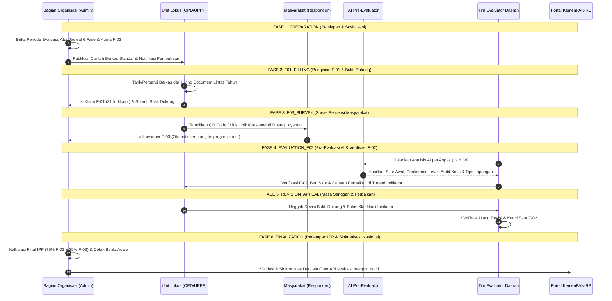

# STANDAR OPERASIONAL PROSEDUR (SOP) DAN JADWAL PELAKSANAAN
## PENYELENGGARAAN EVALUASI PELAYANAN PUBLIK (PEKPPP MANDIRI) DIGITAL
### PEMERINTAH KABUPATEN KUTAI BARAT

---

### BAGIAN I: TATA KELOLA DAN PEMBAGIAN PERAN AKTOR
Dalam ekosistem aplikasi PEKPPP Mandiri Kabupaten Kutai Barat, terdapat 4 (empat) aktor utama dengan hak akses dan tanggung jawab yang terdefinisi secara ketat:

| Aktor / Peran | Instansi / Pelaksana | Tanggung Jawab Utama dalam Sistem |
| :--- | :--- | :--- |
| **1. Koordinator & Super Admin** | Bagian Organisasi Setda | • Menetapkan periode tahun evaluasi dan membuka/menutup 6 fase jadwal (`PeriodWindow`). • Mengurasi **Contoh Berkas** standar dan slot bukti dukung wajib (`EvidenceSlotConfig`). • Menetapkan daftar lokus evaluasi dan menandai **Lokus Prioritas** nasional. • Melakukan sinkronisasi akhir ke API `evaluasi.menpan.go.id` dan mempublikasikan IPP. |
| **2. Tim Evaluator Daerah** | Tim Pembina Pelayanan Publik / Verifikator | • Menjalankan **AI Pre-Evaluator** untuk memindai kelengkapan bukti dukung lokus. • Melakukan verifikasi dokumen dan observasi lapangan untuk mengisi **Formulir F-02**. • Memberikan umpan balik pada utas diskusi per indikator (`IndicatorComment`) dan catatan aspek. • Mencetak dan menandatangani Berita Acara Hasil Evaluasi. |
| **3. Admin Lokus / UPPP (OPD)** | Perangkat Daerah, Kecamatan, RSUD, Puskesmas | • Mengisi penilaian mandiri **Formulir F-01** pada 31 indikator. • Mengunggah atau memperbarui versi bukti dukung pada repositori **Living Document**. • Menyebarkan QR Code / Tautan Survei **F-03** kepada pengguna layanan hingga mencapai target kuota. • Melakukan perbaikan bukti dukung pada masa sanggah/revisi. |
| **4. Masyarakat / Pengguna Layanan** | Publik / Penerima Layanan | • Mengisi kuesioner persepsi masyarakat (**Formulir F-03**) secara daring melalui pemindaian QR Code di ruang layanan. • Menyampaikan aspirasi atau pengaduan layanan melalui kanal **Tiket Pengaduan Terbuka**. |

---

### BAGIAN II: ALUR PROSES 6 TAHAPAN EVALUASI (TIMELINE WINDOWS)
Sistem mengendalikan hak akses pengisian dan perubahan data secara otomatis berdasarkan 6 (enam) fase waktu (`phaseKey` pada tabel `PeriodWindow`):

---

### BAGIAN III: MATRIKS KONTROL IZIN SISTEM PER TAHAPAN
Setiap tahapan di atas diatur di dalam database (`PeriodWindow`) dengan matriks kontrol izin aksi otomatis sebagai berikut:

| No | Kode Fase (`phaseKey`) | Nama Tahapan | Izin Isi F-01 (`canFillF01`) | Izin Unggah Bukti (`canUploadEvidence`) | Izin Survei F-03 (`canFillF03`) | Izin Penilaian F-02 (`canEvaluateF02`) | Output Dokumen / Bukti |
| :---: | :--- | :--- | :---: | :---: | :---: | :---: | :--- |
| 1 | `PREPARATION` | Persiapan & Sosialisasi | ❌ | ❌ | ❌ | ❌ | SK Tim, SK Lokus, Panduan & Contoh Berkas |
| 2 | `F01_FILLING` | Pengisian F-01 & Bukti Dukung | ✅ | ✅ | ✅ | ❌ | Submisi F-01 & Repositori Bukti Dukung 6 Aspek |
| 3 | `F03_SURVEY` | Pengumpulan Survei Masyarakat F-03 | ❌ | ❌ | ✅ | ❌ | Rekapitulasi Responden F-03 (Target $\ge$ 30/Lokus) |
| 4 | `EVALUATION_F02` | Verifikasi & Observasi Evaluator (F-02) | ❌ | ❌ | ❌ | ✅ | Laporan AI Pre-Evaluator & Kertas Kerja F-02 |
| 5 | `REVISION_APPEAL` | Masa Sanggah & Perbaikan Bukti | ✅ *(Revisi)* | ✅ *(Revisi)* | ❌ | ✅ | Riwayat Versi Bukti Baru & Resolusi Komentar |
| 6 | `FINALIZATION` | Penetapan IPP, Berita Acara & Sinkronisasi | ❌ | ❌ | ❌ | ❌ | Berita Acara PDF, Rapor IPP, Log Sinkronisasi MenPAN |

> **Catatan Kontingensi:** Super Admin (Bagian Organisasi) memiliki fitur **Manual Override** (`isActiveOverride`) untuk membuka akses secara selektif apabila terdapat kondisi khusus/dispensasi resmi pada lokus tertentu.

---

### BAGIAN IV: RENCANA JADWAL TAHUNAN (CONTOH TIMELINE PELAKSANAAN)
Berikut adalah rencana jadwal pelaksanaan PEKPPP Mandiri Daerah yang diselaraskan dengan siklus evaluasi nasional KemenPAN-RB:

| Tahapan Kegiatan | Bulan Ke-1 | Bulan Ke-2 | Bulan Ke-3 | Bulan Ke-4 | Bulan Ke-5 | Bulan Ke-6 |
| :--- | :---: | :---: | :---: | :---: | :---: | :---: |
| **1. Persiapan & Penetapan SK Lokus** | ███ | | | | | |
| **2. Sosialisasi & Pemutakhiran Contoh Berkas** | ███ | | | | | |
| **3. Pengisian F-01 & Pembaruan Living Document OPD** | | ████ | ██ | | | |
| **4. Pelaksanaan Survei Masyarakat (F-03 QR Publik)** | | ████ | ████ | | | |
| **5. Pra-Evaluasi AI & Verifikasi Dokumen (F-02)** | | | ██ | ████ | | |
| **6. Verifikasi Lapangan & Masa Sanggah/Revisi** | | | | ██ | ███ | |
| **7. Penandatanganan Berita Acara & Sinkronisasi MenPAN-RB** | | | | | █ | ███ |
| **8. Publikasi Rapor IPP & Pemantauan Tindak Lanjut** | | | | | | ███ |

---

### BAGIAN V: PROSEDUR PENANGANAN BUKTI DUKUNG (LIVING DOCUMENT)
Untuk menjamin efisiensi dan akuntabilitas bukti dukung dari tahun ke tahun, SOP pemberkasan di dalam sistem menerapkan aturan:
1. **Standar Slot per Aspek:**
   - **Aspek I (Kebijakan Pelayanan - Bobot 24%):** SK Standar Pelayanan (14 Komponen), Berita Acara FKP, Dokumentasi Publikasi SP, Maklumat Pelayanan, dan Survei Kepuasan Masyarakat (SKM).
   - **Aspek II (Profesionalisme SDM - Bobot 25%):** Standar Kompetensi/Tupoksi, Kode Etik Pelaksana, Pemberian Penghargaan (*Reward*) & Sanksi (*Punishment*), serta Budaya Pelayanan (5S / Atribut Seragam).
   - **Aspek III (Sarana & Prasarana - Bobot 18%):** Foto fasilitas parkir, ruang tunggu, toilet khusus, laktasi, arena bermain anak, fasilitas disabilitas (*guiding block*, ram, kursi roda), dan *front office*.
   - **Aspek IV (SIPP - Bobot 11%):** Sistem informasi pelayanan daring/non-elektronik, pemutakhiran data berkala, dan integrasi jaringan.
   - **Aspek V (Konsultasi & Pengaduan - Bobot 10%):** Sarana pengaduan, SK petugas pengelola, register tindak lanjut pengaduan, dan integrasi SP4N-LAPOR!.
   - **Aspek VI (Inovasi Pelayanan - Bobot 12%):** Proposal/SK inovasi, bukti dampak peningkatan layanan, serta keikutsertaan kompetisi inovasi (KIPP).
2. **Mekanisme Pohon Versi (*Version Tree*):**
   Saat OPD memperbarui dokumen pada tahun berjalan, berkas tahun sebelumnya tidak terhapus, melainkan tersimpan sebagai riwayat versi (`v1`, `v2`, dst.) lengkap dengan nama pengunggah dan waktu pembaruan. Hal ini memudahkan Tim Evaluator melihat konsistensi perbaikan layanan dari tahun ke tahun.
