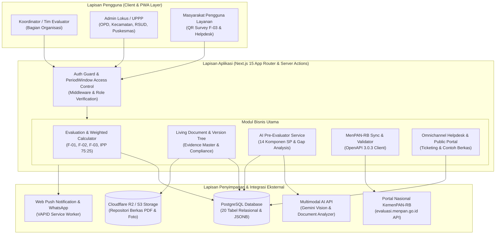
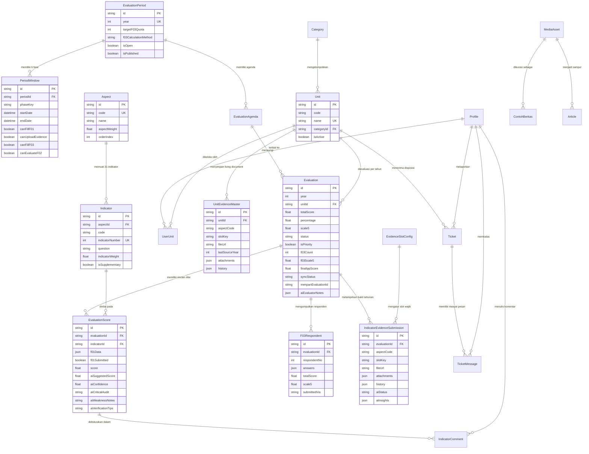
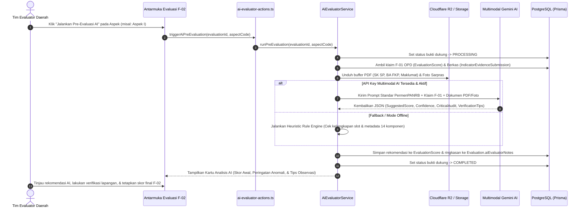
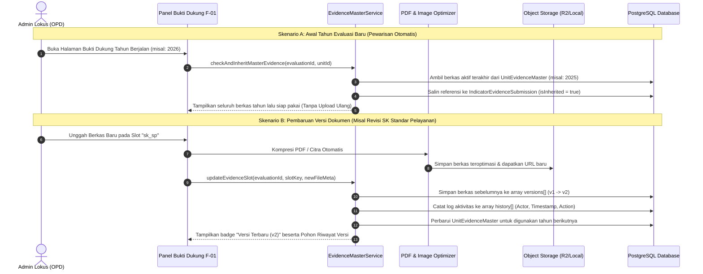
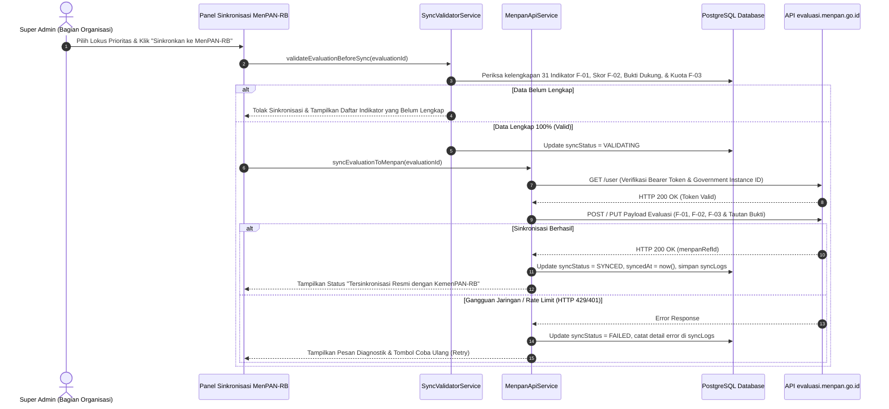

# SPESIFIKASI TEKNIS & RANCANG BANGUN SISTEM (TECHNICAL BLUEPRINT)
## ARSITEKTUR SPBE, BASIS DATA (ERD), DAN PEMODELAN UML
### SISTEM INFORMASI PEKPPP MANDIRI KABUPATEN KUTAI BARAT

---

### 1. PENDAHULUAN & KESELARASAN STANDAR SPBE
Dokumen Spesifikasi Teknis ini disusun sebagai lampiran rancang bangun perangkat lunak (*Software Design Document*) untuk memenuhi standar **Sistem Pemerintahan Berbasis Elektronik (SPBE)** sebagaimana diatur dalam Perpres Nomor 95 Tahun 2018 dan Arsitektur SPBE Nasional.

Aplikasi PEKPPP Mandiri Kabupaten Kutai Barat dirancang dengan prinsip:
1. **Modular & Clean Domain Architecture:** Memisahkan logika bisnis perhitungan regulasi KemenPAN-RB (`src/core/domain`) dari lapisan antarmuka dan akses basis data (`src/services` & `src/actions`).
2. **Interoperabilitas Terbuka (OpenAPI 3.0.3):** Menyediakan modul konektor (`MenpanApiService`) dan validator pra-sinkronisasi (`SyncValidatorService`) untuk pertukaran data langsung dengan portal nasional `evaluasi.menpan.go.id`.
3. **Efisiensi Penyimpanan & Living Document:** Mengimplementasikan arsitektur *Master Evidence Repository* (`UnitEvidenceMaster`) yang mendukung pewarisan dokumen lintas tahun, pohon versi (*version tree*), serta kompresi PDF/citra otomatis sebelum disimpan ke *Object Storage* (*Cloudflare R2 / S3*).
4. **Kecerdasan Buatan Terkendali (*Human-in-the-Loop AI*):** Mengintegrasikan *Multimodal AI Engine* (Google Gemini API) yang dipadukan dengan *Rule-based Heuristic Fallback* untuk menganalisis kelengkapan 14 komponen Standar Pelayanan dan kesesuaian bukti fisik F-01 tanpa mengambil alih wewenang keputusan akhir evaluator manusia.

---

### 2. ARSITEKTUR TEKNOLOGI (TECHNOLOGY STACK)
| Lapisan Sistem | Teknologi yang Digunakan | Fungsi & Peran dalam Arsitektur |
| :--- | :--- | :--- |
| **Application Framework** | Next.js 15 (App Router) + React 19 + TypeScript 5.7 | Kerangka kerja *full-stack* modern dengan *Server Actions* dan *Server-Side Rendering (SSR)* untuk performa tinggi dan keamanan tipe data. |
| **Database & ORM** | PostgreSQL + Prisma ORM 6.3 | Basis data relasional transaksional dengan dukung *JSONB* untuk pohon versi dokumen, log sinkronisasi, dan catatan audit AI. |
| **Cloud Object Storage** | AWS SDK S3 / Cloudflare R2 + Local Fallback | Penyimpanan berkas bukti dukung PDF dan foto sarana-prasarana berkapasitas besar dengan biaya efisiensi tinggi. |
| **Document & Image Processing** | `pdf-lib`, `pdfjs-dist`, `@react-pdf/renderer`, Client Image Compressor | Ekstraksi teks PDF untuk audit AI, optimasi/kompresi ukuran berkas PDF, serta pencetakan Berita Acara resmi secara dinamis. |
| **AI Pre-Evaluator Engine** | Multimodal Gemini AI + Heuristic Rule Engine | Pemindaian dokumen bukti dukung dan foto fasilitas untuk menghasilkan rekomendasi skor, *confidence level*, dan *critical audit*. |
| **Keamanan & Autentikasi** | `jose` (JWT Edge-compatible) + `bcryptjs` | Autentikasi berbasis *JSON Web Token* pada *HTTP-Only Cookie*, *Role-Based Access Control* (`SUPER_ADMIN` & `OPD`), serta *Middleware Guard*. |
| **Notifikasi & PWA** | `web-push` (VAPID) + Integrasi WhatsApp | Dukungan *Progressive Web App* (dapat diinstal di perangkat mobile/desktop) dengan notifikasi *real-time* ke evaluator dan OPD. |

---

### 3. ARSITEKTUR TINGKAT TINGGI (HIGH-LEVEL SYSTEM ARCHITECTURE)

---

### 4. ENTITY RELATIONSHIP DIAGRAM (ERD) — BASIS DATA SISTEM
Basis data terdiri atas **20 entitas tabel** yang saling berelasi secara terstruktur untuk menangani siklus perencanaan periode, instrumen 6 aspek & 31 indikator, penilaian F-01/F-02/F-03, repositori *Living Document*, hingga tiket pengaduan masyarakat.

---

### 5. PEMODELAN UML (UNIFIED MODELING LANGUAGE)

#### 5.1. Diagram Arsitektur Kelas & Layanan Inti (Class / Domain Diagram)
Menggambarkan pemisahan tanggung jawab antara *Domain Calculator*, *AI Evaluator*, *Living Document Master*, dan *MenPAN API Service*.

```mermaid
classDiagram
    class PekpppCalculator {
        +calculatePekpppScore(inputs: IndicatorScoreInput[]) PekpppCalculationResult
        +calculateFinalIpp(f02Scale5: number, f03Scale5: number) number
        +resolvePredicate(percentage: number) GradePredicate
    }

    class PeriodWindowService {
        +getActiveWindows(year: number) PeriodWindow[]
        +checkPermission(year: number, action: PermissionAction) boolean
        +toggleManualOverride(windowId: string, state: boolean) void
    }

    class EvidenceMasterService {
        +inheritFromMaster(evaluationId: string, unitId: string) int
        +syncSubmissionToMaster(submissionId: string) UnitEvidenceMaster
        +appendVersionTree(masterId: string, fileMeta: AttachmentMeta) void
    }

    class AiEvaluatorService {
        +runPreEvaluation(evaluationId: string, aspectCode: string) AiAspectEvaluationResult
        -analyzeWithGeminiMultimodal(files: Buffer[], f01Claims: Json) AiAspectEvaluationResult
        -analyzeWithHeuristicFallback(submissions: Submission[], indicators: Indicator[]) AiAspectEvaluationResult
    }

    class SyncValidatorService {
        +validateForMenpanSync(evaluationId: string) ValidationReport
        +checkF01Completeness(evaluationId: string) boolean
        +checkF02Completeness(evaluationId: string) boolean
        +checkF03Quota(evaluationId: string) boolean
    }

    class MenpanApiService {
        +testConnection() ConnectionResult
        +fetchRemoteEvaluations(year: number) MenpanEvaluationItem[]
        +pushEvaluationScores(evaluationId: string) MenpanSyncResponse
    }

    AiEvaluatorService --> EvidenceMasterService : "membaca berkas bukti"
    MenpanApiService --> SyncValidatorService : "memvalidasi sebelum kirim"
    MenpanApiService --> PekpppCalculator : "mengambil nilai terhitung"
```

---

#### 5.2. Sequence Diagram: Alur Kerja *AI Pre-Evaluator* (Analisis Bukti & Deteksi Anomali F-01)
Menjelaskan bagaimana sistem membantu Tim Evaluator memeriksa klaim F-01 terhadap berkas PDF/foto yang diunggah OPD.

---

#### 5.3. Sequence Diagram: Pewarisan & Pembaruan *Living Document* Lintas Tahun
Menjelaskan mekanisme efisiensi pemberkasan sehingga OPD tidak perlu mengunggah ulang dokumen dari nol setiap tahun.

---

#### 5.4. Sequence Diagram: Validasi & Sinkronisasi ke Portal Nasional (`evaluasi.menpan.go.id`)
Menjelaskan tahapan pengamanan kualitas data sebelum dikirimkan ke server Kementerian PANRB.

---

### 6. SPESIFIKASI KEAMANAN INFORMASI & REKAM JEJAK AUDIT
Untuk memenuhi standar keamanan informasi SPBE (Indeks KAMI / BSSN):
1. **Otorisasi Berlapis (*Defense-in-Depth*):**
   - Setiap rute halaman dan *Server Action* dilindungi oleh `auth-guard.ts` dan `middleware.ts` menggunakan tanda tangan kriptografi JWT (`jose`).
   - Isolasi data ketat antar-unit (`UserUnit`): Akun OPD hanya dapat membaca dan mengubah evaluasi milik unit kerjanya sendiri.
2. **Penguncian Jendela Waktu (*Temporal Access Control*):**
   - Sekalipun pengguna memiliki akun OPD yang sah, sistem menolak perubahan data pada tingkat server apabila fase `PeriodWindow` sedang tertutup (`canFillF01 = false` atau `canUploadEvidence = false`).
3. **Integritas & Auditabilitas Bukti Dukung:**
   - Setiap tindakan pengunggahan, penggantian versi, maupun penghapusan lampiran terekam secara permanen di dalam kolom JSON `history` (`timestamp`, `actorName`, `action`, `fileName`, `fileUrl`).
4. **Kerahasiaan Catatan Internal Evaluator & AI:**
   - Hasil analisis kritis AI (`aiCriticalAudit`, `aiWeaknessNotes`, `aiEvaluatorNotes`) dan pesan internal tiket (`isInternal = true`) diisolasi di sisi server sehingga hanya dapat dilihat oleh Tim Evaluator Daerah (`SUPER_ADMIN`) dan tidak terekspos ke antarmuka OPD maupun publik.
