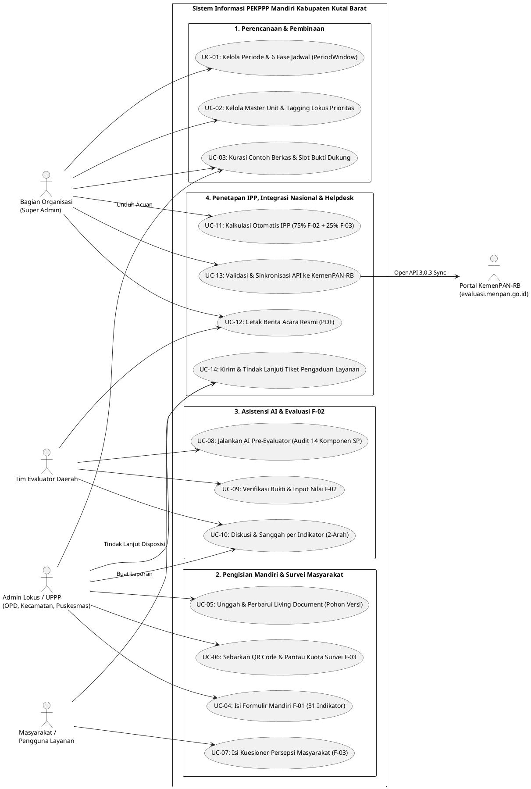
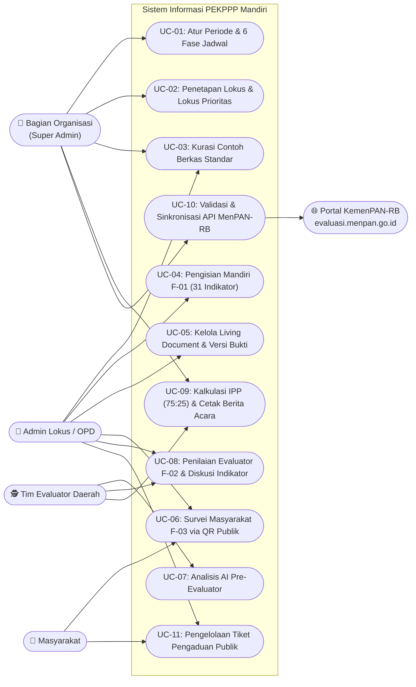
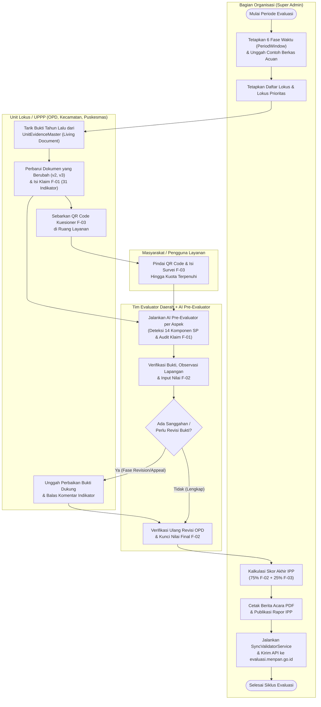
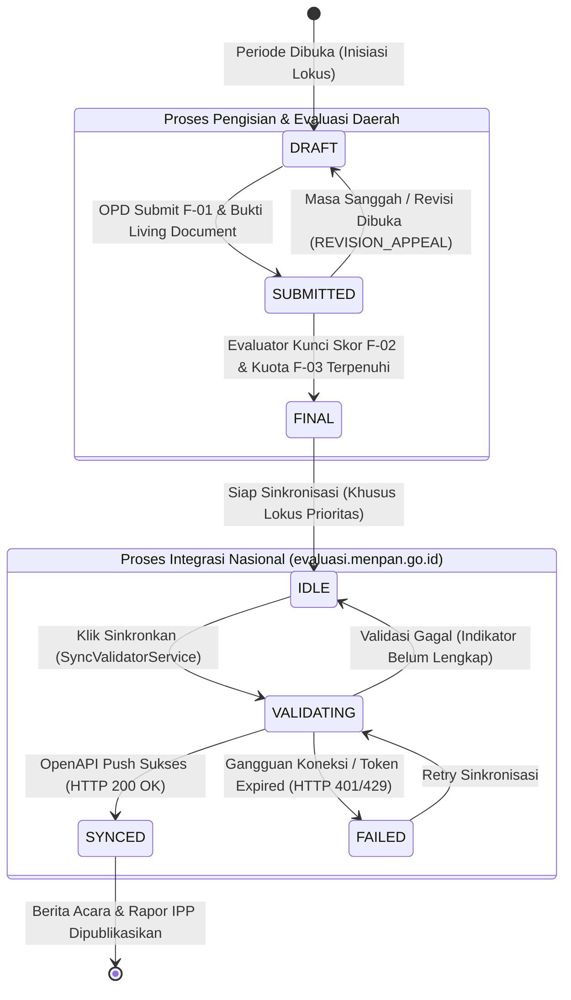

# KUMPULAN KODE SUMBER DIAGRAM (UNTUK TRANSFORMASI KE DRAW.IO / DIAGRAM EDITOR)
## SISTEM INFORMASI PEKPPP MANDIRI KABUPATEN KUTAI BARAT

Dokumen ini berisi kode sumber (**Mermaid**, **PlantUML**, dan **SQL DDL**) yang siap Anda *copy-paste* langsung ke **Draw.io (diagrams.net)** agar otomatis berubah menjadi diagram kotak/panah yang bisa diedit warna, ukuran, dan tata letaknya.

### Cara Import ke Draw.io (diagrams.net):
1. Buka [app.diagrams.net](https://app.diagrams.net/) (Draw.io).
2. Klik menu **Arrange** (Atur) $\rightarrow$ **Insert** (Sisipkan) $\rightarrow$ **Advanced** (Lanjutan) $\rightarrow$ pilih **Mermaid...**, **PlantUML...**, atau **SQL...** sesuai jenis blok kode di bawah ini.
3. *Copy-paste* kode di dalam blok di bawah ini, lalu klik **Insert**.

---

## 1. UML USE CASE DIAGRAM (FORMAT PLANTUML UNTUK DRAW.IO)
> **Cara Pakai di Draw.io:** Menu `Arrange` $\rightarrow$ `Insert` $\rightarrow$ `Advanced` $\rightarrow$ `PlantUML...`  
> *(Atau gunakan blok Mermaid Flowchart di bagian 1B jika ingin bentuk kotak yang bisa digeser satu per satu di Draw.io).*

### 1A. Kode PlantUML (Standar Gambar Aktor & Oval Use Case)


### 1B. Kode Mermaid Use Case (Native Editable Shapes di Draw.io)
> **Cara Pakai di Draw.io:** Menu `Arrange` $\rightarrow$ `Insert` $\rightarrow$ `Advanced` $\rightarrow$ `Mermaid...`



---

## 2. UML ACTIVITY DIAGRAM / CROSS-FUNCTIONAL SWIMLANE (MERMAID UNTUK DRAW.IO)
> **Cara Pakai di Draw.io:** Menu `Arrange` $\rightarrow$ `Insert` $\rightarrow$ `Advanced` $\rightarrow$ `Mermaid...`  
> Diagram ini memetakan alur kerja lintas aktor (*Swimlane*) dari perencanaan hingga pelaporan ke KemenPAN-RB.



---

## 3. ENTITY RELATIONSHIP DIAGRAM (ERD) — SQL DDL UNTUK DRAW.IO
> **Cara Pakai Paling Rapi di Draw.io:**  
> Di Draw.io, klik menu **Arrange** $\rightarrow$ **Insert** $\rightarrow$ **Advanced** $\rightarrow$ **SQL...**, lalu *paste* skrip SQL di bawah ini. Draw.io akan langsung membuat **Tabel ERD Profesional lengkap dengan kotak kolom PK/FK** yang siap dihubungkan!

```sql
CREATE TABLE EvaluationPeriod (
  id VARCHAR(36) PRIMARY KEY,
  year INT UNIQUE NOT NULL,
  title VARCHAR(100),
  targetF03Quota INT DEFAULT 30,
  f03CalculationMethod VARCHAR(20) DEFAULT 'PROPORTIONAL',
  isOpen BOOLEAN DEFAULT TRUE,
  isPublished BOOLEAN DEFAULT FALSE,
  publishedAt TIMESTAMP
);

CREATE TABLE PeriodWindow (
  id VARCHAR(36) PRIMARY KEY,
  periodId VARCHAR(36) REFERENCES EvaluationPeriod(id),
  phaseKey VARCHAR(50) NOT NULL,
  title VARCHAR(150) NOT NULL,
  startDate TIMESTAMP,
  endDate TIMESTAMP,
  canFillF01 BOOLEAN DEFAULT FALSE,
  canUploadEvidence BOOLEAN DEFAULT FALSE,
  canFillF03 BOOLEAN DEFAULT FALSE,
  canEvaluateF02 BOOLEAN DEFAULT FALSE,
  isActiveOverride BOOLEAN
);

CREATE TABLE Category (
  id VARCHAR(36) PRIMARY KEY,
  name VARCHAR(100) UNIQUE NOT NULL,
  slug VARCHAR(100) UNIQUE NOT NULL
);

CREATE TABLE Unit (
  id VARCHAR(36) PRIMARY KEY,
  code VARCHAR(50),
  name VARCHAR(200) UNIQUE NOT NULL,
  categoryId VARCHAR(36) REFERENCES Category(id),
  isActive BOOLEAN DEFAULT TRUE
);

CREATE TABLE Profile (
  id VARCHAR(36) PRIMARY KEY,
  email VARCHAR(150) UNIQUE NOT NULL,
  fullName VARCHAR(150) NOT NULL,
  phone VARCHAR(30),
  role VARCHAR(20) DEFAULT 'OPD'
);

CREATE TABLE UserUnit (
  id VARCHAR(36) PRIMARY KEY,
  userId VARCHAR(36) REFERENCES Profile(id),
  unitId VARCHAR(36) REFERENCES Unit(id)
);

CREATE TABLE Aspect (
  id VARCHAR(36) PRIMARY KEY,
  code VARCHAR(20) UNIQUE NOT NULL,
  name VARCHAR(150) NOT NULL,
  aspectWeight FLOAT NOT NULL,
  orderIndex INT NOT NULL
);

CREATE TABLE Indicator (
  id VARCHAR(36) PRIMARY KEY,
  aspectId VARCHAR(36) REFERENCES Aspect(id),
  code VARCHAR(30) NOT NULL,
  indicatorNumber INT UNIQUE NOT NULL,
  question TEXT NOT NULL,
  indicatorWeight FLOAT NOT NULL,
  maxScore FLOAT DEFAULT 5.0,
  isSupplementary BOOLEAN DEFAULT FALSE
);

CREATE TABLE Evaluation (
  id VARCHAR(36) PRIMARY KEY,
  year INT NOT NULL,
  unitId VARCHAR(36) REFERENCES Unit(id),
  totalScore FLOAT DEFAULT 0,
  percentage FLOAT DEFAULT 0,
  scale5 FLOAT DEFAULT 0,
  status VARCHAR(20) DEFAULT 'DRAFT',
  isFinished BOOLEAN DEFAULT FALSE,
  isPriority BOOLEAN DEFAULT FALSE,
  f03Count INT DEFAULT 0,
  f03Scale5 FLOAT DEFAULT 0,
  finalIppScore FLOAT DEFAULT 0,
  aiEvaluatorNotes JSON,
  syncStatus VARCHAR(20) DEFAULT 'IDLE',
  menpanEvaluationId VARCHAR(100),
  syncedAt TIMESTAMP
);

CREATE TABLE EvaluationScore (
  id VARCHAR(36) PRIMARY KEY,
  evaluationId VARCHAR(36) REFERENCES Evaluation(id),
  indicatorId VARCHAR(36) REFERENCES Indicator(id),
  f01Data JSON,
  f01Submitted BOOLEAN DEFAULT FALSE,
  score FLOAT,
  notes TEXT,
  aiSuggestedScore FLOAT,
  aiConfidence FLOAT,
  aiCriticalAudit TEXT,
  aiWeaknessNotes TEXT,
  aiVerificationTips TEXT
);

CREATE TABLE IndicatorComment (
  id VARCHAR(36) PRIMARY KEY,
  evaluationScoreId VARCHAR(36) REFERENCES EvaluationScore(id),
  authorId VARCHAR(36) REFERENCES Profile(id),
  message TEXT NOT NULL,
  isResolved BOOLEAN DEFAULT FALSE,
  parentId VARCHAR(36)
);

CREATE TABLE F03Respondent (
  id VARCHAR(36) PRIMARY KEY,
  evaluationId VARCHAR(36) REFERENCES Evaluation(id),
  respondentNo INT NOT NULL,
  name VARCHAR(100),
  answers JSON NOT NULL,
  totalScore FLOAT DEFAULT 0,
  scale5 FLOAT DEFAULT 0,
  submittedVia VARCHAR(30) DEFAULT 'PUBLIC'
);

CREATE TABLE EvidenceSlotConfig (
  id VARCHAR(36) PRIMARY KEY,
  aspectCode VARCHAR(10) NOT NULL,
  slotKey VARCHAR(50) NOT NULL,
  title VARCHAR(200) NOT NULL,
  isMandatory BOOLEAN DEFAULT TRUE,
  orderIndex INT DEFAULT 0
);

CREATE TABLE IndicatorEvidenceSubmission (
  id VARCHAR(36) PRIMARY KEY,
  evaluationId VARCHAR(36) REFERENCES Evaluation(id),
  aspectCode VARCHAR(10) NOT NULL,
  slotKey VARCHAR(50) NOT NULL,
  slotConfigId VARCHAR(36) REFERENCES EvidenceSlotConfig(id),
  title VARCHAR(200) NOT NULL,
  fileUrl TEXT NOT NULL,
  storageProvider VARCHAR(30) DEFAULT 'R2',
  isInherited BOOLEAN DEFAULT FALSE,
  attachments JSON,
  history JSON,
  aiStatus VARCHAR(20) DEFAULT 'IDLE',
  aiInsights JSON
);

CREATE TABLE UnitEvidenceMaster (
  id VARCHAR(36) PRIMARY KEY,
  unitId VARCHAR(36) REFERENCES Unit(id),
  aspectCode VARCHAR(10) NOT NULL,
  slotKey VARCHAR(50) NOT NULL,
  title VARCHAR(200) NOT NULL,
  fileUrl TEXT NOT NULL,
  lastSourceYear INT,
  attachments JSON,
  history JSON
);

CREATE TABLE MediaAsset (
  id VARCHAR(36) PRIMARY KEY,
  title VARCHAR(200) NOT NULL,
  category VARCHAR(50) DEFAULT 'UMUM',
  fileName VARCHAR(200) NOT NULL,
  fileUrl TEXT UNIQUE NOT NULL,
  fileType VARCHAR(30) NOT NULL,
  isPublic BOOLEAN DEFAULT TRUE
);

CREATE TABLE ContohBerkas (
  id VARCHAR(36) PRIMARY KEY,
  mediaAssetId VARCHAR(36) REFERENCES MediaAsset(id),
  title VARCHAR(200) NOT NULL,
  category VARCHAR(100) NOT NULL,
  isActive BOOLEAN DEFAULT TRUE
);

CREATE TABLE Ticket (
  id VARCHAR(36) PRIMARY KEY,
  ticketCode VARCHAR(30) UNIQUE NOT NULL,
  title VARCHAR(200) NOT NULL,
  category VARCHAR(100) NOT NULL,
  priority VARCHAR(20) DEFAULT 'MEDIUM',
  status VARCHAR(20) DEFAULT 'OPEN',
  isAnonymous BOOLEAN DEFAULT FALSE,
  authorId VARCHAR(36) REFERENCES Profile(id),
  targetUnitId VARCHAR(36) REFERENCES Unit(id),
  resolutionNotes TEXT
);

CREATE TABLE TicketMessage (
  id VARCHAR(36) PRIMARY KEY,
  ticketId VARCHAR(36) REFERENCES Ticket(id),
  senderId VARCHAR(36) REFERENCES Profile(id),
  senderRole VARCHAR(20),
  message TEXT NOT NULL,
  isInternal BOOLEAN DEFAULT FALSE
);
```

---

## 4. STATE MACHINE DIAGRAM — SIKLUS STATUS EVALUASI & SINKRONISASI (MERMAID UNTUK DRAW.IO)
> **Cara Pakai di Draw.io:** Menu `Arrange` $\rightarrow$ `Insert` $\rightarrow$ `Advanced` $\rightarrow$ `Mermaid...`


